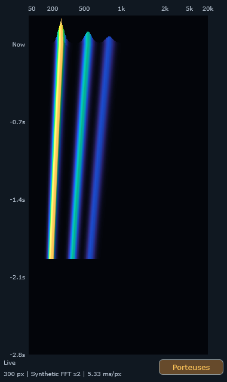
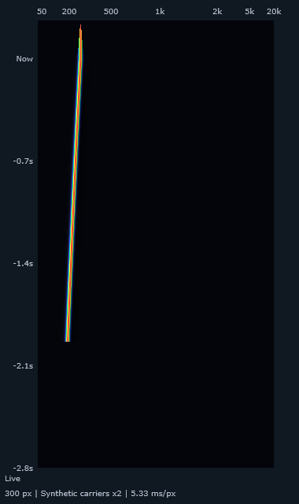
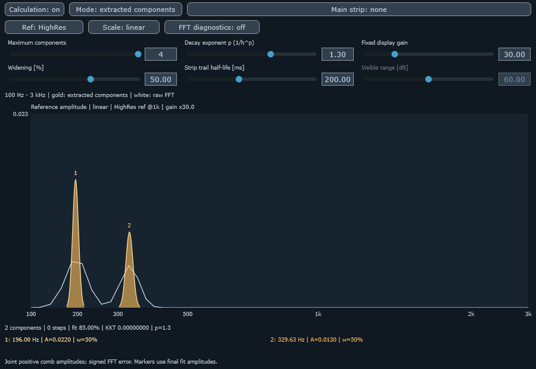

# Optional spectrum histories and pitch observations

The Classic spectrum remains the initial view. The visualization button in Pro
opens a menu for HighRes, two independent history windows, the experimental pitch
window, and an optional compact observation band. No analysis window opens by
itself. The compact band starts at None. The existing HighRes preference is still
saved; window visibility, compact selection and experimental controls are
session-only settings.

These views observe the output through the analysis worker from PR #634. They do
not change playback samples, routing, DSP effects, output reserve or the driver.
The callback's opaque observation token now also carries a request-session epoch,
so an in-flight block cannot become the first observation of a reopened view.

## Synthetic widget previews

These are unedited **synthetic snapshots of production widgets**, exported
offscreen by the versioned harness using JUCE 9.0.5. They are not live music
captures, full application windows or evidence of native Windows DPI behavior.

## Views and frequency readouts

* **HighRes** adds a frequency axis below the existing stereo bars. Hovering the
  plot reports the actual centre frequency published with that bar snapshot.
  Labels use the same warped frequency mapping as the analyzer. The upper limit
  is the smaller of 20 kHz and Nyquist, not an assumed 48 kHz device format.
* **Spectrum history** scrolls FFT display bands with a live peak silhouette.
  Its optional gold carrier overlay is an explicit additional model request.
* **Carrier history** uses the inherited harmonic-carrier presentation as a
  separate history consumer. Both history axes use the actual sample rate;
  hovering reports the frequency at the pointer. It is a position readout, not a
  claim that a peak or note exists there.
* **Experimental pitch analysis** has transport-histogram, spectral-correlation
  and harmonic-carrier tabs. It is an observation experiment, not a validated
  monophonic note detector. Chords, transients, weak fundamentals and short FFT
  resolution can produce ambiguous estimates.
* **Compact observation band** offers None, Pitch movement or Carriers. It is
  independent of opening the pitch window. The pitch window's Main strip button
  cycles these same three real states. Double-click a compact plot for details.

## Experimental controls

The movement/correlation controls are shared model settings:

| Control | Effect and initial value |
| --- | --- |
| Smoothed / instantaneous histogram | Chooses which movement distribution is drawn; comparison lags do not change. |
| Histogram memory | Movement-histogram smoothing time, initially 0.20 s; zero shows the instantaneous distribution. |
| Integral memory | Leaky memory for the secondary movement integral, initially 2 s. |
| Transport scale | Distance scale of the transport model, initially 6 semitones. |
| Background floor strength | Spectral background subtraction before weighting, initially 1. |
| Peak prominence | Minimum contrast above the background, initially 6 dB. |
| Peak power exponent | Initially 2, emphasizing dominant peaks; 1 retains energy weighting. Correlation applies half the exponent before normalization. |
| Baseline / dominant weighting | Sets the preceding three conditioning controls together to 0/0 dB/1 or 1/6 dB/2. |

The harmonic tab exposes inherited controls:

| Control | Effect and initial value |
| --- | --- |
| Calculation | Enables harmonic calculation; disabling it does not disable the other observations. |
| Extracted components / legacy profile | Selects joint iterative component fitting or the earlier single-family cancellation model. |
| Maximum components / subtracted fraction | In iterative mode, up to four accepted components with early stopping. In legacy mode, the cancellation fraction, initially 0.75. |
| Decay exponent | Amplitude template proportional to `1/h^p`, initially **1.3**. |
| Widening | Initially **50%**; includes additional gradual bass widening of the fundamental. Higher harmonics keep the chosen regular widening. |
| HighRes / flat reference | Uses the existing frequency reference anchored at 1 kHz for candidate ranking and marker display, or bypasses it. FFT-domain subtraction keeps unweighted fitted amplitudes. |
| Fixed display gain | Initially 30; changes the fixed display reference rather than normalizing each frame to its largest peak. |
| Linear / dB and visible range | Display scaling; the initial dB range is 60 dB when logarithmic display is selected. |
| Strip trail half-life | Opacity decay of old compact markers, initially 200 ms; zero removes the trail. It does not establish component identities or smooth pitch. |
| FFT diagnostics | Adds the reconstructed model and positive fit error to the detailed plot. |

Display timing is the fixed inherited 50% reference. This port does not expose the
private global timing slider: it would imply control over a hybrid analyzer that
is not part of this contribution.

## Demand, visibility and shutdown

The controller sends one union of explicit requests to the worker. Classic alone
requests no FFT or pitch model. FFT history and HighRes do not implicitly request
pitch models. Closing or minimizing one consumer withdraws its request without
resetting another open history or shared model. A main-spectrum transition clears
only its bar/clip holds. Model calculations remain outside snapshot-publication
locks; the producer performs bounded observation work.

The two history windows and the pitch window have one GUI owner. Shutdown first
blocks new menu/visibility requests, detaches providers and callbacks, stops view
clocks, and destroys these windows on the GUI thread before UIA/COM teardown.

## Difference from the private reference

The port comes from committed reference `d1ccaf6`, excluding later uncommitted
zoom/magnifier work. It retains the public analyzer: FFT 2048, hop 512. The private
pitch input also used its 2048 FFT; its raw bin arrays came from that short FFT,
while private display bands additionally used 4096/8192 hybrid analysis. The public
port therefore retains the numerical pitch input resolution, but does not promise
the private history-band rendering or its extra two-hop short-branch delay and
longer warm-up.

A separate comparison with the exact private `d1ccaf6` source matched the true
`firstSample` and compared complex left/right bins and mean power. Across 24
synthetic mono/stereo cases at 8/44.1/48/192 kHz, short-only analysis matched
696 windows (3,567,000 floats) bit for bit; the private hybrid's common short
windows matched 408 windows (2,091,000 floats). Its 288 unmatched public windows
were explicitly excluded from the latter comparison. Maximum difference was
zero. This proves the compared raw FFT windows; it does not establish equal
hybrid display bands, delivery times, model warm-up histories or audible output.

Model validity checks are not a musical-accuracy qualification. In the inherited
rich 150 Hz PCM fixture, none of the 13 analyzed frames recovered a component
within half a semitone of the fundamental. That count is deliberately diagnostic,
not a passed accuracy assertion: solver consistency and finite output do not
establish correct fundamental identification. This limitation is preserved in
the experiment rather than hidden by its successful numerical test count.

## Validation boundary

Portable numerical tests cover analyzer, histories, models and request/session
transitions. The separate GUI harness uses actual production widgets with
synthetic snapshots and exports at 100%, 175% and 200%. JUCE logs and unexpected
assertions are captured to stderr; Debug CRT reports cannot open a dialog in that
test process. Build and test results must be supplied from the final run.

Offscreen exports do not establish native Windows peer DPI behavior. The harness
does not construct the FxSound controller, touch a profile or an audio endpoint,
or run the interactive application. Real menus, auxiliary-window interaction,
device changes and audible behavior remain a manual validation boundary unless
separately exercised.
