# FxSound DSP Tutorial: from raw PCM to enhanced audio

This guide shows what happens behind the scenes when FxSound processes your audio, and what changes when you move
a setting. It starts with how digital audio is stored (PCM samples and dBFS levels), then follows the audio through
each stage of FxSound's DSP (digital signal processing) engine in the order the engine runs them. It assumes only
basic audio knowledge.

**▶ [Open the interactive tutorial][tutorial]**. It is an interactive guide to FxSound's audio processing that runs
in your browser. Play piano notes, change the same controls the FxSound app has, and watch the waveform and
spectrum change while you listen to the result. Every picture in this guide was made with it. Its processing is a
JavaScript port of FxSound's C engine (`dsp/`), and it produces **bit-for-bit identical output** to the real
engine (see [How faithful is the simulator?](#9-how-faithful-is-the-simulator)).

<!-- Published by .github/workflows/publish-dsp-tutorial.yml. If the page moves (e.g. to a custom domain), update this single link. -->
[tutorial]: https://fxsound2.github.io/fxsound-app/dsp-tutorial/

## Contents

1. [Digital audio in one page: PCM](#1-digital-audio-in-one-page-pcm)
2. [Loudness in dBFS](#2-loudness-in-dbfs)
3. [The piano notes](#3-the-piano-notes)
4. [Where FxSound sits](#4-where-fxsound-sits)
5. [The processing chain, in order](#5-the-processing-chain-in-order)
6. [Each stage, explained](#6-each-stage-explained)
7. [Controls reference](#7-controls-reference)
8. [Behaviours worth knowing](#8-behaviours-worth-knowing)
9. [How faithful is the simulator?](#9-how-faithful-is-the-simulator)
10. [Running the tutorial yourself](#10-running-the-tutorial-yourself)
11. [Glossary](#11-glossary)

---

## 1. Digital audio in one page: PCM

Sound is a pressure wave. A microphone turns it into a voltage that rises and falls with the wave.
**PCM (pulse-code modulation)** stores that voltage as a list of numbers:

- **Sampling.** The wave is measured at regular instants. At **44,100 samples per second** (44.1 kHz, the CD rate)
  the measurements are 22.7 µs apart. A sample rate can only represent frequencies up to half its value (the
  *Nyquist frequency*): 22,050 Hz at 44.1 kHz, just above the ~20 kHz limit of human hearing.
- **Quantization.** Each measurement is rounded to the nearest whole number on a fixed scale. With **24 bits**
  there are 16,777,216 possible values, from **−8,388,608 to +8,388,607**. These integers are the *codes*
  stored in a 24-bit WAV file. One step is 1/8,388,608 of full scale (about −138 dBFS), so 24-bit audio
  has roughly 144 dB of dynamic range.
- **Channels.** Stereo stores a left and a right sample for each instant, interleaved: L, R, L, R, …

To play the audio, the sound card turns the codes back into a voltage. Software such as FxSound works with the same
values as decimals (−1.0 to +1.0): a code divided by 8,388,608.

### Reading the tutorial's graphs

The tutorial shows the same audio in four views. In every view the colours mean the same thing:

| Colour | Meaning |
|---|---|
| Grey | The **original** audio, before FxSound. Drawn first. |
| Red | The audio **after FxSound**. Drawn on top of the original and partly see-through to make the original visible. |
| Blue | Spectrum view: the **difference** (output minus original), i.e. only what FxSound changed. Gain view: Volume Leveling's gain. |
| Violet | Spectrum view: the **equalizer's response**, read on the right-hand axis. |
| Dashed grey line | The sample you are inspecting. |

- **Waveform**: the whole clip. Horizontal: time in seconds. Vertical: sample value from −1 to +1 (full scale), with
  the left channel in the top lane and the right channel in the bottom lane. The screen has fewer pixels than the
  clip has samples, so each pixel column draws a thin bar from the lowest to the highest sample in that slice of
  time. The outline of the bars is the *envelope*: how loud the sound is at each moment. An option switches the
  vertical scale to dBFS, which makes quiet details such as a reverb tail visible.
- **Samples (zoom)**: about 5 ms of the left channel, with every sample drawn as a dot. The vertical scale zooms to
  fit the signal.
- **Spectrum**: how much energy is at each frequency, on a logarithmic frequency axis from 20 Hz to 20 kHz. A note
  appears as a row of peaks: its fundamental and its harmonics.
- **Gain over time**: how much Volume Leveling and Dynamic Boost turn the audio up or down, in dB.

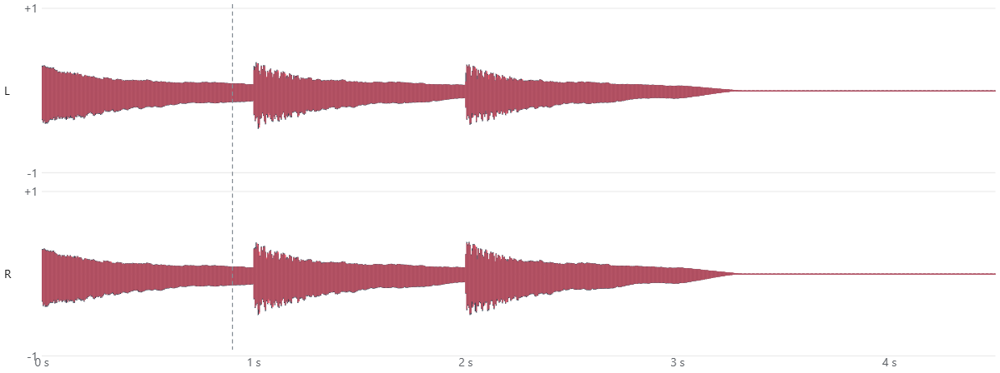

*Waveform view of the melody C4 D4 E4 (three half notes at 120 bpm), peaking at −6 dBFS, with every FxSound control
at zero. Each note starts loud (the hammer strike) and fades. The output is almost identical to the original
(0.3 dB quieter, see [Behaviours worth knowing](#8-behaviours-worth-knowing)), so the red output covers the grey
original everywhere, and the grey showing through makes the whole envelope a darker red.*

Zoom in far enough and the smooth wave becomes individual samples:

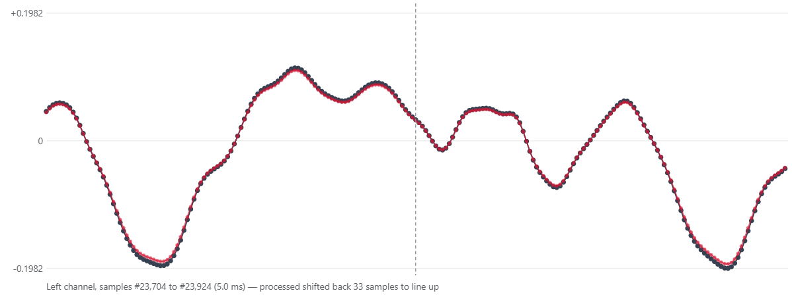

*Samples view: about 5 ms of the left channel during C4. Each dot is one sample. Middle C (261.6 Hz) takes
168.6 samples per cycle at 44.1 kHz. The red output dots sit just inside the grey ones: that is the 0.3 dB the
limiter takes off.*

## 2. Loudness in dBFS

**dBFS (decibels relative to full scale)** measures a level against the largest value a sample can hold.
0 dBFS is full scale; everything else is negative.

| Level | Linear value | 24-bit code |
|---|---|---|
| 0 dBFS | 1.000 | 8,388,607 (full scale) |
| −6 dBFS | 0.501 | 4,204,263 |
| −12 dBFS | 0.251 | 2,107,123 |
| −20 dBFS | 0.100 | 838,861 |
| −60 dBFS | 0.001 | 8,389 |

Two numbers describe a signal's level:

- **Peak**: the single largest sample. It tells you whether the signal can clip (exceed full scale).
- **RMS** (root mean square): the average power, which is closer to how loud the sound *feels*. Music typically
  has its RMS level 12–20 dB below its peak.

The tutorial's **Peak level** slider scales your melody so its loudest sample sits exactly at the level you choose.

## 3. The piano notes

The tutorial's keyboard has the white keys from C1 to C7 (43 notes), tuned in equal temperament with A4 = 440 Hz:
each semitone up multiplies the frequency by the twelfth root of 2 (about 1.059), so every octave doubles it.
Each key shows its frequency, and the page's **Which frequency is each key?** panel lists them all. A few landmarks:
C1 = 32.7 Hz, C4 (middle C) = 261.6 Hz, A4 = 440 Hz, C7 = 2093 Hz.

A real piano string doesn't produce a single frequency. It vibrates at its fundamental plus **harmonics**
(2×, 3×, 4× … the fundamental), which give the instrument its timbre. The tutorial synthesizes notes the same way:
up to 24 harmonics, slightly stretched upward as on a real string, each fading at its own rate. Each note rings
briefly into the next, as when playing legato.

## 4. Where FxSound sits

FxSound installs a virtual sound card, **FxSound Audio Enhancer**. Windows sends all system audio to it; FxSound
processes it and passes it on to your real speakers or headphones. By the time audio reaches FxSound it is already
decoded **raw PCM**. MP3, AAC or streaming formats are decoded earlier by the playing application and Windows.
FxSound receives the samples as 32-bit floating-point numbers and processes them in blocks (buffers) of a few
milliseconds each.

## 5. The processing chain, in order

Every buffer goes through the same stages in the same order. They are grouped into two parts:

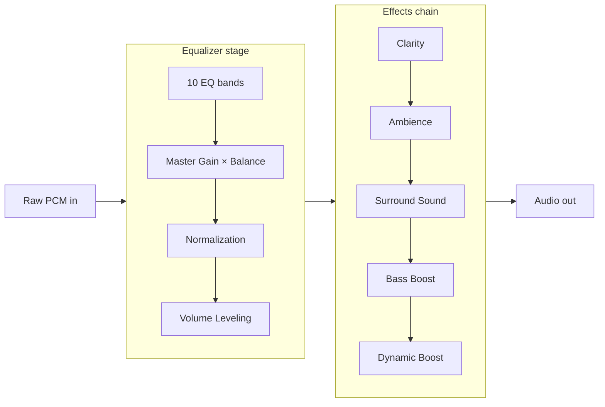

An effect whose slider is at 0 is switched off, with one exception: **Dynamic Boost always runs** when the power is
on, because it is also FxSound's safety limiter.

**Power and the equalizer switch.** The DSP engine has two switches: power, and an on/off switch for the whole
equalizer stage. The FxSound app only has the **Power** button. The equalizer stage is always on, and the app never
calls the engine's equalizer switch. So in the app there are just two cases:

| Power button | What you hear |
|---|---|
| On | Everything in the diagram above |
| Off | The original audio. The app switches Windows back to your real output device, so audio no longer passes through FxSound at all. |

The engine itself supports more combinations (`dsp/ptutil/dfxp/dfxpProcessReal.cpp`). They can't be reached from
the app, but they explain the code:

| Engine power | Engine equalizer | What the engine runs |
|---|---|---|
| On | On | Everything (the app's normal state) |
| On | Off | The effects chain only. The *whole* equalizer stage is skipped, including Master Gain, Balance and Volume Leveling. |
| Off | On | Master Gain only (but the app has already routed audio away from FxSound) |
| Off | Off | Nothing |

The tutorial behaves like the app: its Power switch bypasses FxSound completely, and it has no equalizer switch.

## 6. Each stage, explained

The pictures below use the views described in [Reading the tutorial's graphs](#reading-the-tutorials-graphs). Some
captures untick Dynamic Boost in the tutorial's *Isolate a stage* list, so that the blue difference curve shows only
the stage being explained and not the limiter's fixed −0.3 dB.

### Equalizer bands

The equalizer has 10 bands centred at 62.5, 116, 214, 397, 735, 1360, 2520, 4670, 8640 and 16000 Hz, each ±12 dB.
Each band is a **peaking filter** (a *biquad*): it boosts or cuts a range of frequencies around its centre and leaves
the rest untouched. A band at 0 dB leaves its frequencies unchanged, with no boost or cut. The engine doesn't even
run that band's filter, which saves processing.

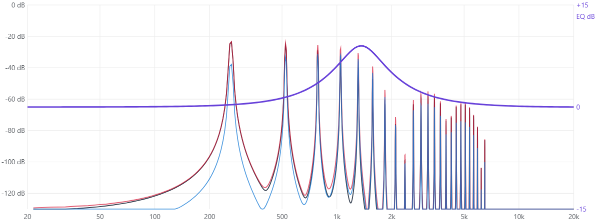

*Spectrum view of the C4–D4–E4 melody with the 1.36 kHz band at +9 dB. Grey is the original spectrum and
red the output; where they match, the red line lies on top of the grey one. The violet bell (right axis) is the equalizer's
response: harmonics under the bell (roughly 700 Hz to 4 kHz) come out up to 9 dB louder, so the red peaks there
stand above the grey ones. Blue is the difference: the sound the equalizer added. It is largest under the bell. It
also shows smaller changes away from the bell, because a filter slightly shifts the timing (phase) of nearby
frequencies even where it doesn't change their level.*

**Filter Q** sets how *wide* each band's bell is. "Q" stands for *quality factor*. Think of it as the opposite of
width:

- **Low Q (Filter Q = 1)**: a wide, gentle bell. Boosting the 1.36 kHz band also lifts frequencies an octave or more
  away. Good for broad tone changes such as "a bit more presence".
- **High Q (Filter Q = 3)**: a narrow, steep bell. Only frequencies close to 1.36 kHz change. Good for targeted
  fixes such as taming one harsh frequency.

The height of the bell stays the gain you set; only its width changes. For 10 bands the base Q is about 1.6, and the
Filter Q control multiplies it, so the bands' Q goes from 1.6 (×1) to 4.8 (×3). One detail: for small boosts or
cuts the engine automatically widens the band. Below 6 dB, Q is capped at 3.3 × |gain in dB| + 0.2.

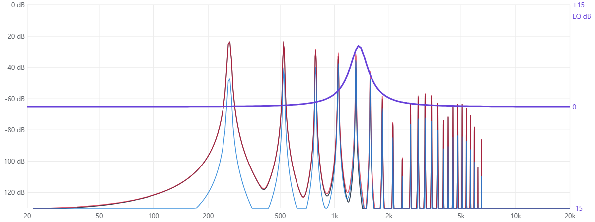

*The same +9 dB at 1.36 kHz with Filter Q at 3. The violet bell is now much narrower, so only the harmonics close to
1.36 kHz get louder; compare it with the picture above.*

### Master Gain and Balance

**Master Gain** (−20 to +20 dB) multiplies every sample: +6 dB doubles the amplitude. **Balance** (−20 to +20 dB)
turns one channel *down*. Positive values reduce the left channel and negative values the right. It never turns
either channel up.

### Volume Leveling

Volume Leveling (0–4) steers loudness toward a target, adapting once per buffer:

- The control sets the target RMS level: about **−18, −12 and −6 dBFS** at settings 1, 2 and 4.
- Louder audio is turned down; quieter audio is turned up, normally by at most ×1, ×2 or ×4 at those settings.
- If the audio stays **quiet but audible for about 10 seconds**, it may turn it up by as much as ×10 (+20 dB), ramping
  in over 2 seconds. "Quiet" means an RMS below about −29 dBFS; "audible" means peaks above about −49 dBFS.
  Silence doesn't count, and a gap of silence restarts the 10-second timer.
- It also measures tonality (muffled vs. clear) and recent headroom, and adjusts its target slightly for both.

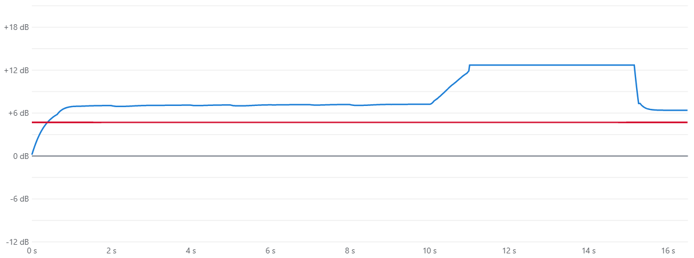

*Gain over time for a quiet melody (peaks at −30 dBFS) repeated for 15 s, with Volume Leveling at 2 and Dynamic
Boost at 3. Blue is the leveling gain. It quickly settles near +7 dB, then rises to +12.7 dB once the quiet has
lasted 10 seconds, and falls back when the music stops. Red is Dynamic Boost's gain (+4.7 dB at slider 3).*

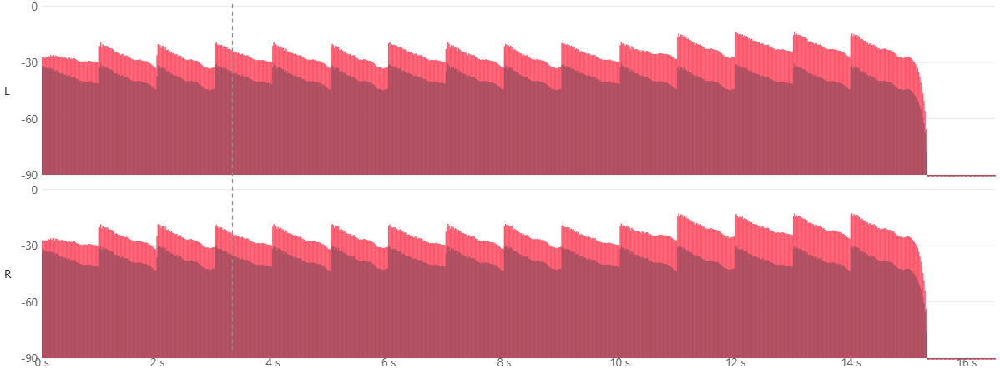

*The same melody in the Waveform view with the dBFS scale. The darker lower area is the grey original
seen through the red: it stays near −30 dBFS throughout. The red-only band above it is how much louder FxSound
made it. The band is about 12 dB tall at first and grows to about 17 dB after the 10-second mark.*

### Normalization

Normalization is a second automatic volume control inside the equalizer stage, between Master Gain and Volume
Leveling. For each buffer it:

1. measures the RMS level of the stereo audio coming out of the equalizer bands, Master Gain and Balance;
2. compares it with a target level (the Normalization setting in dB, where 0 dB is full scale);
3. if the audio is louder than the target, turns it down quickly, by as much as −40 dB. When the audio gets
   quieter again it lets the gain recover slowly, but **never above 0 dB**. Normalization only ever reduces the
   level; it can't make quiet audio louder.

At its default setting of 0 dB the target is full scale, which no RMS level can exceed, so the engine skips the
block entirely. The FxSound app has no Normalization control, so the setting always stays at that default.

How it compares with Volume Leveling:

| | Normalization | Volume Leveling |
|---|---|---|
| Turns loud audio down | Yes | Yes |
| Turns quiet audio up | No (the gain is capped at 0 dB) | Yes: up to ×4 normally, ×10 after 10 s of quiet |
| Considers tone and headroom | No | Yes |
| Channels | Stereo only | Stereo and multichannel |
| Control in the FxSound app | None: fixed at 0 dB, so switched off | Volume Leveling slider (0–4) |

**Why there is no Normalization control.** Everything Normalization does, Volume Leveling already does: it pulls
loud audio down toward its target. It also lifts quiet audio and allows for tone and headroom. Offering both
would give users two automatic volume controls that do overlapping jobs, running one after the other and pulling
the level in different directions. Keeping Normalization at its default 0 dB is the same as removing it, because
the engine doesn't run it at all. That leaves Volume Leveling as the single, easy-to-understand loudness control.

### Clarity

Clarity (called *Fidelity* inside the engine) makes the treble sound crisper and more detailed, a little like the
brightness a slightly overdriven amplifier or tape machine adds. It works in three steps:

1. **Copy the treble.** A filter makes a copy of just the high frequencies, above about 1.7 kHz. Bass and midrange
   are not copied, so they are left alone.
2. **Gently distort the copy.** The copy is pushed through a smooth curve that rounds off its peaks. Bending a wave
   like this creates new, higher overtones (harmonics) that weren't in the recording, which the ear hears as
   sparkle and detail.
3. **Mix it back in.** The distorted copy is added to the original.

The slider sets how hard the copy is pushed: higher settings add more new overtones.

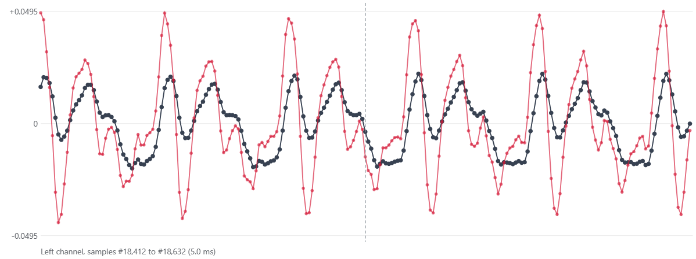

*Samples view of the note C6 with Clarity at 10 (Dynamic Boost unticked). The grey original is C6's own wave. The
red output has the same rhythm, but its peaks are taller and sharper and it has extra small wiggles between
them: those are the added high overtones.*

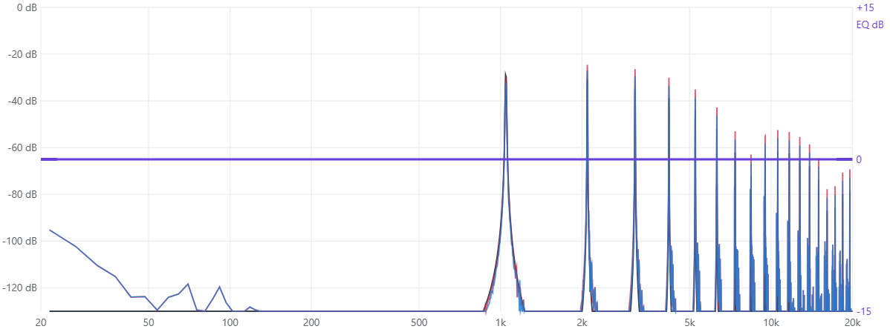

*The same moment in the Spectrum view. The blue difference shows the added treble. At the maximum setting it is
almost as strong as the note's own harmonics; lower settings add much less.*

### Ambience

Ambience is a **plate reverb**: a network of delays and all-pass filters that creates a dense, decaying echo. The
slider sets the decay time and how much reverb is mixed in. In FxSound's default music mode the reverb is deliberately
subtle: its tail sits roughly 25–30 dB below the music.

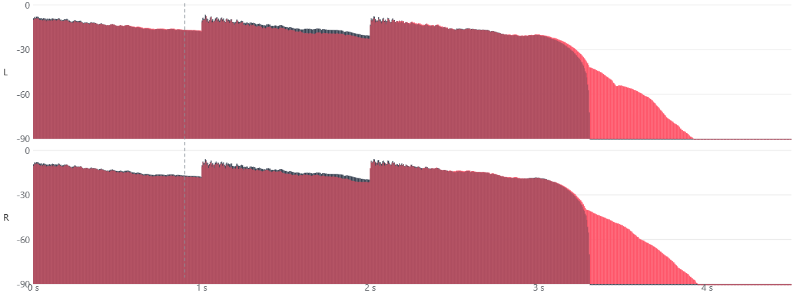

*Ambience at 8, in the Waveform view with the dBFS scale. While the notes play, the red output covers the grey original.
After the last note (from about 3.3 s) the original stops, but the red reverb tail decays from roughly −45 dBFS to
silence over about half a second. On a normal (linear) scale this tail is too quiet to see.*

### Surround Sound

Surround Sound uses **mid/side** processing. *Mid* is what both channels share, (L + R) / 2; *side* is how they differ.
The side part is boosted, by up to ×3.1 at slider 10, and the mid part reduced slightly (×0.79), so the two channels
move further apart and the sound seems wider. A mono signal has no side part, so it only gets a little quieter.

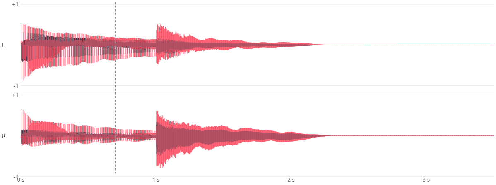

*C3 (panned left) followed by E5 (panned right), with Surround at 10. Each note's red output grows beyond the
original in its own channel and, in the other channel, partly cancels: the grey original shows beyond the red where the
output became smaller.*

### Bass Boost

Bass Boost is a single peaking filter at **90 Hz** (Q 2.5), adjustable from 0 to 15 dB. Low notes change most; notes
above a few hundred hertz barely change.

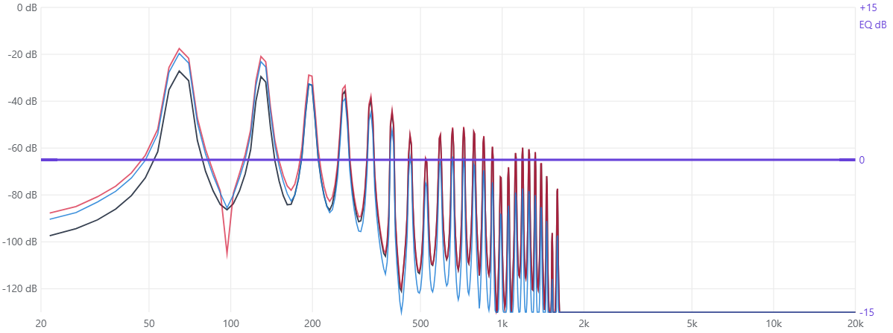

*C2, E2 and G2 with Bass Boost at 10: fundamentals around 65–100 Hz rise by up to about 9 dB; harmonics above 300 Hz
are unchanged.*

### Dynamic Boost

Dynamic Boost raises the overall level and keeps every peak at or below **−0.3 dBFS** with a **look-ahead limiter**.
It delays the audio by 0.75 ms (33 samples at 44.1 kHz), so it can see a loud peak coming and lower the gain before
the peak reaches the output. It doesn't add harmonics.

- The slider is not linear: positions 1–5 give about **+1.6, +3.1, +4.7, +6.6 and +10 dB**, and 6–10 all give
  **+11.6 dB**.
- The boost backs off automatically when the music is already loud, but never below about +0.5 dB.
- Its level detector looks at the left channel only, and applies the same gain to both channels.

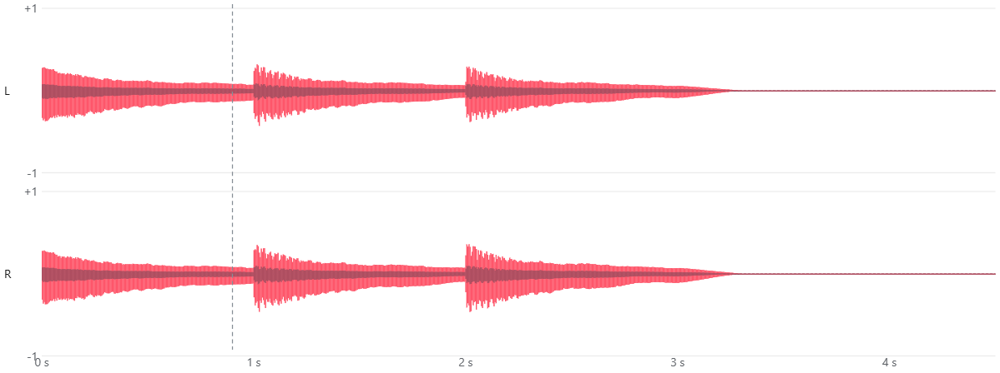

*A melody peaking at −18 dBFS with Dynamic Boost at 6. The original is the darker core (grey seen through
the red); the red envelope around it is the boosted output, about four times larger, with its peaks still
below −0.3 dBFS.*

## 7. Controls reference

These are the controls in the FxSound app. The app has no equalizer on/off switch and no Normalization control
(see [section 5](#5-the-processing-chain-in-order) and [Normalization](#normalization)).

| Control | Range (step) | What it changes in the engine |
|---|---|---|
| Power | on / off | Off: audio is routed straight to your output device and bypasses FxSound |
| Clarity | 0–10 (1) | Drive into the exciter's sine curve, 0 to 3.39 |
| Ambience | 0–10 (1) | Reverb decay (0.095–0.95 exponential scale) and reverb mix |
| Surround Sound | 0–10 (1) | Side gain 1 → 3.1, mid gain 1 → 0.79 |
| Dynamic Boost | 0–10 (1) | Boost 0, 1.6, 3.1, 4.7, 6.6, 10.0, then 11.6 dB |
| Bass Boost | 0–10 (1) | 90 Hz peaking filter, 0 to 15 dB |
| EQ bands ×10 | −12 to +12 dB (1) | One peaking filter per band; 0 dB = filter not run |
| Master Gain | −20 to +20 dB (2) | Multiplies every sample |
| Balance | −20 to +20 dB (2) | Attenuates the left (+) or right (−) channel |
| Filter Q | 1–3 (0.5) | Multiplies the bands' base Q (≈ 1.6), making every bell narrower |
| Volume Leveling | 0–4 (0.5) | Target RMS = setting ÷ 8 (−18 dBFS at 1, −12 at 2, −6 at 4); 0 = off |

Each effect slider value *s* becomes an internal value from 0 to 127: (s ÷ 10) × 127, rounded. In FxSound's default
music mode, Ambience uses that value × 0.34, and Dynamic Boost uses it × 1.8 (capped at 127), then × 0.7, before
the engine's lookup tables. That is why their sliders feel non-linear.

## 8. Behaviours worth knowing

- **FxSound is never a perfect bypass when powered on.** With every control at zero the output is 0.3 dB quieter
  and 0.75 ms later than the input, and peaks are limited to −0.3 dBFS. That is Dynamic Boost acting as a safety
  limiter. Power off *is* a perfect bypass, because the audio no longer goes through FxSound.
- **Dynamic Boost saturates at slider 6.** Positions 6–10 sound the same.
- **Ambience at 1–3 is unusual.** At 1 and 2 the reverb is mixed in with a small *negative* level (subtracted) and
  the original is raised slightly above its own level; at 3 the reverb runs but is mixed in at zero.
- **Silence resets Volume Leveling's quiet boost.** It needs continuous, audible quiet audio for about 10 seconds.
- **Very loud audio gets a small boost even with Dynamic Boost at 0** (about +0.5 dB before limiting).

## 9. How faithful is the simulator?

The tutorial's processing (`web/dsp-tutorial/js/dsp/`) is a line-by-line port of the engine's C code. It uses
32-bit floating-point arithmetic wherever the C code does, and 64-bit only where the C code does.

To check it, the real engine was built from `dsp/` (commit `d8e7a23`) and driven through its public `DfxDsp` interface
with the same audio and settings as the tutorial. Across 24 scenarios — each effect at several settings, equalizer
boosts and cuts, Filter Q, Master Gain and Balance, Volume Leveling over 16 seconds, and the engine's power and
equalizer switches — the tutorial's output matched the engine's **exactly, sample for sample**.

Differences from the real app:

- The tutorial processes a whole clip at once in 10 ms buffers. In the app, Windows decides the buffer size. Volume
  Leveling adapts once per buffer, so its timing can differ slightly.
- The tutorial runs at 44.1 kHz only. The engine also supports other sample rates and multichannel audio.
- The piano is synthesized, not recorded.
- The *stage* switches (step 4 of the tutorial) exist only in the tutorial. They let you remove one stage at a time.

## 10. Running the tutorial yourself

The tutorial is a static web page with no build step and no external dependencies. Its source is in
[`web/dsp-tutorial`](../web/dsp-tutorial). Download the folder and open `index.html` in a browser, or see its
[README](../web/dsp-tutorial/README.md) for hosting and testing notes.

## 11. Glossary

| Term | Meaning |
|---|---|
| Biquad | A small, efficient digital filter used for equalizer bands and Bass Boost |
| Buffer | A block of samples processed together (here 441 samples, 10 ms) |
| dBFS | Decibels relative to digital full scale; 0 dBFS is the maximum |
| Envelope | The outline of a waveform: how loud it is from moment to moment |
| Harmonic | A whole-number multiple of a note's fundamental frequency |
| Look-ahead | Delaying audio slightly so a limiter can react to peaks before they arrive |
| Mid / side | The sum and the difference of the left and right channels |
| Nyquist frequency | Half the sample rate: the highest frequency a sample rate can represent |
| PCM | Pulse-code modulation: audio stored as a list of numbered samples |
| Q | How narrow a filter's band is; higher Q means narrower |
| RMS | Root mean square: the average power of a signal, close to perceived loudness |
| Sample rate | Samples per second, per channel (44,100 here) |
