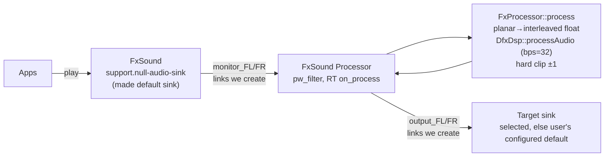

# Linux port architecture

What actually runs on Linux, traced from the code (not the file names).

## Components
| Area | Path | Notes |
|---|---|---|
| App / GUI | `fxsound/Source` (JUCE 6.1.6), `CMakeLists.txt` | `FxController` owns `DfxDsp` and `AudioPassthru` |
| DSP engine | `dsp/` (`DfxDsp` facade → `DfxDspPrivate` → `ptutil/dfxp`, `ptechDsp`) | shared with Windows; built by `dsp/DfxDsp.cmake` |
| Settings store | `dsp/linux/reg_linux.cpp` | replaces the Windows registry; `$XDG_CONFIG_HOME/fxsound/registry.ini` |
| Audio backend | `audiopassthru/src/linux/AudioPassthruPipeWire.cpp` | libpipewire; `FxProcessor` (`PipeWireProcess.h`) is the realtime block |
| Tray | `linux/tray/fx_tray_sni.cpp` | StatusNotifierItem + dbusmenu over GDBus, own GLib thread |
| Hotkeys | `linux/LinuxHotkeys.cpp` | XCB, mutex-protected bindings |
| Header shims | `dsp/linux/*.h`, generated `<build>/lc_headers` | Windows SDK stand-ins; case-insensitive include bridge |

## Audio data flow

- Format: 32-bit float, 2 channels (FL/FR only), graph rate from `position->clock.rate.denom`.
- Both link sets are recreated by `reroute()` on every node/port registry event.
- On startup the backend sets `default.configured.audio.sink` to FxSound and restores the captured previous value in the destructor.

## Threads
| Thread | Runs | Touches |
|---|---|---|
| JUCE message thread | GUI, `FxController`, DSP setters (`setEqBandBoostCut`, `powerOn`, presets) | `DfxDsp` parameter memory, `reg_linux` (writes + file I/O) |
| PipeWire RT thread | `on_process` → `FxProcessor` → `DfxDsp::processAudio` | same `DfxDsp` memory; `reg_linux` reads every block (bypass, tuned track) |
| `pw_thread_loop` | registry/metadata events, `reroute()`, link creation | graph model; calls `AudioPassthruCallback::onSoundDeviceChange` |
| GLib thread | tray | posts to the message thread |
| XCB thread | hotkeys | mutex-protected bindings |

The DSP engine has no synchronization between the message thread and the RT
thread; see `DECISIONS.md` (DEC-4) and `KNOWN_ISSUES.md`.
